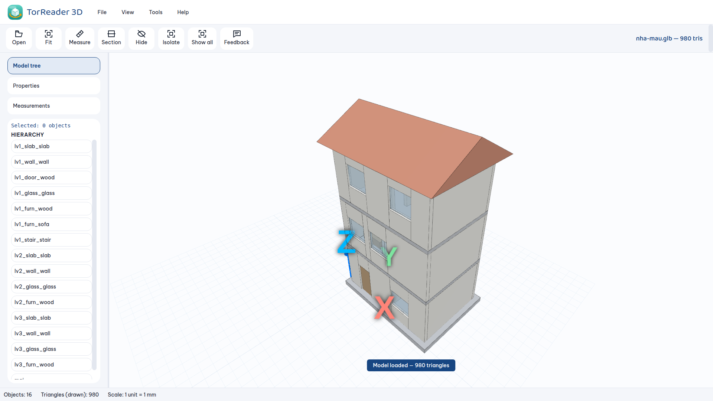

<h1 align="center">TorReader 3D</h1>

  
  
  
  

A lightweight 3D viewer for architects and engineers. Open SketchUp, GLB and IFC models, orbit smoothly, measure with point snapping and read element properties — free, no account.

- **Open SKP, GLB and IFC** (IFC2x3 / IFC4) — click an element to see its properties; model tree by storey.
- **Convert OBJ, FBX, DAE and STL** to GLB.
- **Smooth navigation** that stays light on ordinary laptops.
- **Measure** distance, edge length, area and angle with point snapping.
- **Section, hide, isolate**, export GLB and screenshots.

## Download
Get `TorReader3D-…-win64-setup.exe` from [torreader.cloud](https://torreader.cloud) or [Releases](https://github.com/FelixNgH/TorReader3D/releases/latest). Windows 10/11, 64-bit.

## Feedback
[TorReader Discord](https://discord.gg/GMQYM59rAt) → **#feedback-3d**.

More apps: [torreader.cloud](https://torreader.cloud) — TorReader PDF · TorSlides · TorVerse · TorReader 3D. © B&B Creations.
